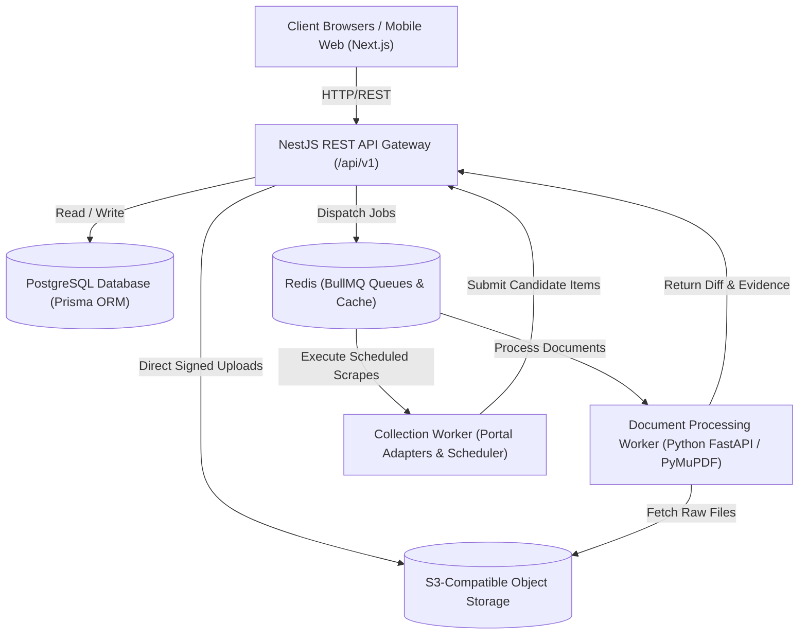

# Tender Corrigendum & Amendment Tracker

> **A standalone, auditable procurement information system** designed to track post-publication changes, corrigenda, addenda, and cancellations across tenders, preserving version history, detecting modifications with verifiable evidence, and keeping stakeholders informed in real time.

---

## 📌 Executive Summary

Government and corporate procurement processes frequently issue updates, clarifications, deadline extensions, and technical amendments (corrigenda) after initial tender publication. Missing an amendment often leads to disqualification, non-compliant bids, or lost opportunities. 

The **Tender Corrigendum & Amendment Tracker** centralizes tender notices and amendment documents from manual staff submissions and automated portal collection adapters. It extracts text, compares document versions, identifies structured changes (dates, financial values, eligibility, technical criteria), and routes them to a human review workbench before creating immutable audit-trailed history events and broadcasting targeted alerts to subscribed users.

---

## 🚀 Key Capabilities

- **Multi-Source Collection**: Unified manual entry workbench and automated, rate-limited portal collectors.
- **Document Intelligence**: High-accuracy PDF text extraction with OCR fallback (PyMuPDF + Tesseract).
- **Automated Change Detection & Diff**: Field-level structured comparisons and visual side-by-side textual diffs with document page references.
- **Human-in-the-Loop Review**: Machine suggestions remain provisional until authorized reviewers verify and approve changes.
- **Immutable Version History**: Every approved amendment generates an immutable version snapshot (`TenderVersion`), preserving the full tender journey.
- **Followers & Notifications**: In-app notifications and email alert dispatch for followed tenders when new amendments are approved.
- **Comprehensive Audit Trail**: Append-only security logging for all privileged actions, data alterations, and system agent runs.
- **Analytics & Export**: Aggregated procurement trend reports and CSV/PDF data exports.

---

## 🏛️ System Architecture



---

## 📂 Repository Structure

```text
.
├── apps/
│   ├── web/                    # Next.js 14+ frontend application (Tailwind CSS, Radix UI)
│   └── api/                    # NestJS REST API server (RBAC, Prisma, BullMQ, Swagger)
├── services/
│   ├── document-processing/    # Python FastAPI service (PyMuPDF, Tesseract OCR, Diff Engine)
│   └── collection-worker/      # Background crawler & portal adapter ingestion engine
├── packages/
│   ├── shared-types/           # Common TypeScript interfaces, DTOs, and enums
│   └── config/                 # Shared environment validations and constants
├── prisma/
│   ├── schema.prisma           # Relational PostgreSQL database schema
│   └── seed.ts                 # Realistic development seed dataset with Corrigenda 01-03
├── docs/                       # Technical blueprints and operational specifications
│   ├── PRD.md                  # Complete Product Requirements Document
│   ├── ARCHITECTURE.md         # Detailed System Architecture & Data Flow
│   ├── DATABASE.md             # ERD, Data Dictionary, and Indexing Strategy
│   ├── API.md                  # Comprehensive REST API Specification
│   ├── AGENTS.md               # Intelligent Worker & Agent Pipeline Specification
│   ├── SETUP.md                # Local Developer Setup & Quickstart Guide
│   ├── TESTING.md              # Test Strategy, Test Cases (TC-001 - TC-020) & QA Checklist
│   ├── DEBUGGING.md            # Troubleshooting Matrix & Diagnostic Procedures
│   └── RUNBOOK.md              # Operations, Incident Response, & Backup/Restore Plan
├── docker-compose.yml          # Local container orchestration (Postgres, Redis, MinIO, Services)
├── .env.example                # Canonical environment variables template
└── README.md                   # This project guide
```

---

## 🛠️ Quick Start

### 1. Prerequisites
- **Node.js**: v18.x or v20.x LTS
- **pnpm**: v8.x or v9.x (recommended) or npm v9+
- **Python**: 3.10+ (for Document Processing microservice)
- **Docker & Docker Compose**: For local PostgreSQL, Redis, and MinIO instances

### 2. Configure Environment
```bash
cp .env.example .env
```
*(Verify local database passwords and port configurations in `.env`)*

### 3. Start Local Infrastructure
```bash
docker compose up -d postgres redis minio
```

### 4. Install Dependencies
```bash
pnpm install
```

### 5. Setup Database & Seed Data
```bash
pnpm prisma generate
pnpm prisma migrate dev --name init
pnpm db:seed
```

### 6. Start Development Servers
```bash
# Terminal 1: Start API & Web Apps
pnpm dev

# Terminal 2: Start Document Processing Worker
cd services/document-processing
python -m venv .venv
# On Windows: .venv\Scripts\activate | On Unix: source .venv/bin/activate
pip install -r requirements.txt
uvicorn app.main:app --reload --port 8001
```

Access the applications:
- **Web Portal**: [http://localhost:3000](http://localhost:3000)
- **REST API & Swagger Docs**: [http://localhost:4000/api/docs](http://localhost:4000/api/docs)
- **Document Processing Health**: [http://localhost:8001/health](http://localhost:8001/health)
- **MinIO Storage Console**: [http://localhost:9001](http://localhost:9001) (`minioadmin` / `minioadmin`)

---

## 👥 Default Demo Credentials (Development Seed)

| Role | Email | Password | Permissions |
| :--- | :--- | :--- | :--- |
| **Super Admin** | `admin@tender-tracker.local` | `Admin@12345` | Full system control, user management, source adapters, audit logs |
| **Reviewer** | `reviewer@tender-tracker.local` | `Reviewer@12345` | Corrigendum intake, comparison workbench, review & approve/reject |
| **Registered User** | `contractor@example.com` | `User@12345` | Search tenders, follow tenders, receive alerts, view timeline |

---

## 🔒 Security & Data Integrity Principles

1. **Never Overwrite History**: Original tender details and approved intermediate corrigenda states are strictly immutable.
2. **Provenance & Evidence**: Every extracted change records source URL, SHA-256 checksum, page index, and context text.
3. **Role-Based Server Authorization**: Server-side guards inspect roles on every API invocation (`Super Admin`, `Reviewer`, `Registered User`).
4. **Human Verification Barrier**: Automated diffs and AI summaries are marked `PENDING` until a human reviewer accepts or corrects them.

---

## 📄 License
This project is licensed under the MIT License - see the [LICENSE](LICENSE) file for details.

