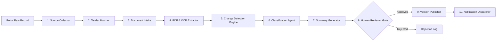

# Intelligent Agents & Asynchronous Processing Pipeline

## 1. Architectural Philosophy of Agents

In the **Tender Corrigendum & Amendment Tracker**, "Agents" are defined as specialized, deterministic, observable micro-workers with single responsibilities, bounded execution runtimes, structured JSON schemas, and append-only audit tracking. They do not operate as unchecked autonomous entities; they strictly assist human reviewers.

---

## 2. Agent Catalog & Job Contracts

### 2.1 Source Collector Agent (`SourceCollectorWorker`)
- **Mission**: Ingest permitted listing feeds and downloadable documents from public portal sources.
- **Guardrails**:
  - Strictly respects robots.txt, configured rate limits (default 2s interval), and allowed domains.
  - Aborts immediately on HTTP 403 / 429 and logs a structured warning.
  - Computes `sha256` of fetched payload immediately; skips unchanged content.

### 2.2 Tender Matching Agent (`TenderMatchingWorker`)
- **Mission**: Resolve ambiguous candidate corrigenda to existing tenders in the database.
- **Matching Heuristics**:
  1. Exact match on `normalized_tender_number` (Confidence: 1.0)
  2. Exact match on `source_tender_ref` (Confidence: 0.98)
  3. Fuzzy match on Organization + Title similarity > 0.85 (Confidence: 0.75)
- **Policy**: Any match with confidence < 0.95 is flagged as `AMBIGUOUS_MATCH` and routed to the Reviewer's unlinked queue.

### 2.3 Document Intake Agent (`DocumentIntakeWorker`)
- **Mission**: Validate file format, MIME signature, extract embedded metadata, and upload to S3 object storage.
- **Safety Checks**:
  - Rejects executable or non-PDF binary payloads.
  - Caps single document upload size (default 50MB) and maximum pages (default 250 pages).

### 2.4 PDF & OCR Extraction Agent (`PdfOcrWorker`)
- **Mission**: Convert PDF binary files into structured page-by-page text streams.
- **Execution Flow**:
  1. Attempt native text extraction using PyMuPDF (`fitz`).
  2. If page text density is < 20 alphanumeric characters, classify page as scanned image.
  3. Dispatch rasterized image to Tesseract OCR (with configurable language packs: English, Gujarati, Hindi).
  4. Output structured JSON: `{ pageNumber: 1, isOcr: true, text: "...", blocks: [...] }`.

### 2.5 Change Detection & Diff Agent (`DiffEngineWorker`)
- **Mission**: Compare base tender documents against revised corrigenda documents to extract delta items.
- **Techniques**:
  - Sequence matching on normalized sentences.
  - Regular expression extractors for dates (e.g., `last date for submission is extended to DD/MM/YYYY`).
  - Currency and financial extractors (e.g., EMD amounts, tender fees).
  - Outputs structured `AmendmentChange` records with `old_value`, `new_value`, `page`, and `context`.

### 2.6 Classification Agent (`ClassificationWorker`)
- **Mission**: Tag identified changes into standardized procurement categories:
  - `DEADLINE_EXTENSION`: Changes to submission date, opening date, pre-bid meeting.
  - `ELIGIBILITY_CRITERIA`: Changes to turnover requirements, prior experience years, certifications.
  - `FINANCIAL_TERMS`: Changes to tender fee, EMD amount, payment milestones.
  - `TECHNICAL_SPECIFICATION`: Changes to BOQ (Bill of Quantities), drawings, materials.
  - `CANCELLATION` / `REOPENING`: Termination or reactivation notices.

### 2.7 AI Summary Agent (`SummaryWorker` - Optional)
- **Mission**: Synthesize dense corrigenda legal text into a 3-bullet plain-English executive summary.
- **Safety & Prompt Injection Defenses**:
  - System prompt strictly constrains model to output only facts present in extracted evidence.
  - Clearly marked with `isAiGenerated: true` and `provisional: true`.
  - Reviewers can edit or discard the summary before publishing.

### 2.8 Notification Dispatcher Agent (`NotificationWorker`)
- **Mission**: Broadcast multi-channel alerts (in-app + email) to users following the updated tender.
- **Idempotency**:
  - Generates event keys: `sha256(userId + amendmentId + channel)`.
  - Prevents accidental duplicate delivery during worker retries.

