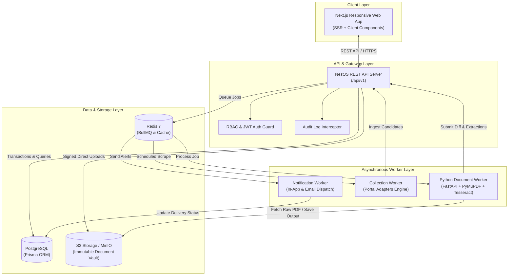
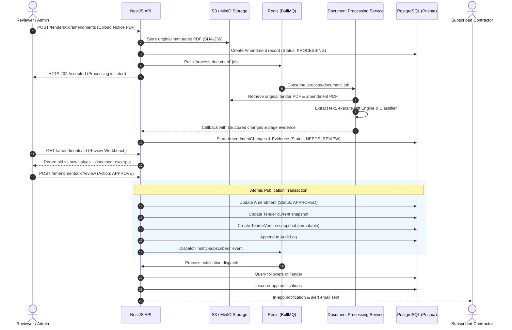

# System Architecture & Technical Design

## 1. Architectural Overview

The **Tender Corrigendum & Amendment Tracker** is constructed as an asynchronous, event-driven, decoupled service architecture designed for high data integrity, auditable traceability, and scalable document processing.

---

## 2. Component Specifications

### 2.1 Next.js Web Application (`apps/web`)
- **Framework**: Next.js 14+ (App Router, React Server Components where appropriate)
- **Styling**: Tailwind CSS with Radix UI headless primitives and Lucide Icons
- **Key Modules**:
  - `TenderTimeline`: Chronological visual journey showing issuance through all published corrigenda.
  - `VersionDiffViewer`: Side-by-side and inline document comparison highlighting additions (green), deletions (red), and modified values (amber).
  - `ReviewWorkbench`: Dedicated split-screen reviewer interface displaying source document page citations alongside machine-detected changes.
  - `AdminSourceConsole`: Management interface for portal configurations, rate limits, and collection health.

### 2.2 NestJS API Gateway (`apps/api`)
- **Framework**: NestJS (TypeScript) with Express/Fastify adapter
- **Key Responsibilities**:
  - Request validation via `class-validator` and `class-transformer`
  - Authentication (Argon2id/Bcrypt password hashing, JWT token issuance)
  - Role-Based Access Control (`@Roles('SUPER_ADMIN', 'REVIEWER')`)
  - Transactional database operations via Prisma ORM
  - Audit interceptors capturing before/after states for all mutation operations
  - Queue management and job orchestration via BullMQ

### 2.3 Document Processing Microservice (`services/document-processing`)
- **Framework**: Python 3.10+ FastAPI
- **Engines**:
  - **PyMuPDF (`fitz`)**: Lightning-fast native text extraction, font metadata, and table boundary identification from digital PDFs.
  - **Tesseract OCR / pdf2image**: Image-to-text conversion for scanned or non-searchable PDF pages.
  - **Diff Engine**: Computes token-level, sentence-level, and tabular diffs between base tender documents and revised notices.
  - **Classifier**: Pattern matching and rule-based entity recognition for dates, currency values, qualification periods, and EMD amounts.

### 2.4 Ingestion & Collection Worker (`services/collection-worker`)
- **Framework**: TypeScript Node.js background process
- **Capabilities**:
  - Pluggable portal adapter architecture (`TenderPortalAdapter`)
  - Exponential backoff retry policies and domain-level rate limiting
  - Checksum hashing (SHA-256) for deduplication at source fetch time
  - Candidate record staging into `CollectionItem` table prior to matching

---

## 3. Core Operational Workflows & Sequence Diagrams

### 3.1 Corrigendum Upload, Processing, & Review Workflow

---

## 4. Scalability & Resilience Policies

1. **Decoupled Heavy Computation**: Document parsing and OCR never run on the web/API thread. They execute in isolated worker containers with resource limits (CPU/Memory caps).
2. **Graceful Degradation**: If an external portal changes layout or rate-limits requests, the adapter transitions to `PAUSED` or `BLOCKED` status without impacting the rest of the application.
3. **Idempotent Webhooks & Retries**: Queue jobs feature unique job IDs based on `sha256(tenderId + documentChecksum)` to prevent duplicate ingestion.

