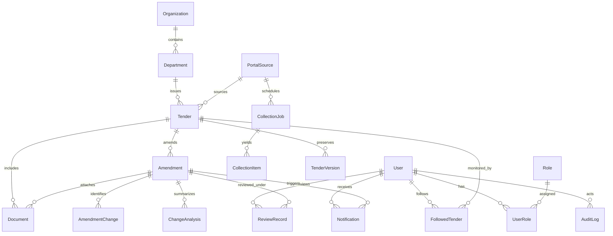

# Database Design & Data Dictionary

## 1. Entity-Relationship Overview

The database is built on **PostgreSQL** using **Prisma ORM** as the typed data access and schema management layer. The schema is normalized (3NF) for relational integrity while utilizing JSONB fields for dynamic document evidence, page coordinates, and audit deltas.

---

## 2. Core Tables & Data Dictionary

### 2.1 `users` & Access Control
- `id` (UUID, Primary Key): Unique internal user identifier.
- `email` (VarChar 255, Unique): Case-insensitive user email.
- `password_hash` (VarChar 255): Argon2id or Bcrypt hashed password.
- `name` (VarChar 255): Full name.
- `status` (Enum: `ACTIVE`, `SUSPENDED`, `PENDING_VERIFICATION`).
- `created_at`, `updated_at`, `last_login_at` (Timestamps).

### 2.2 `portal_sources` (Registry of Ingestion Portals)
- `id` (UUID, Primary Key): Unique portal identifier.
- `name` (VarChar 255): Display name (e.g., "CPPP National eProcurement").
- `base_url` (Text): Canonical website address.
- `adapter_key` (VarChar 100): Code identifier for the portal adapter module.
- `collection_method` (Enum: `API`, `RSS_FEED`, `PERMITTED_HTML`, `MANUAL_ONLY`).
- `is_enabled` (Boolean, Default `true`).
- `schedule_cron` (VarChar 100): Cron schedule expression (e.g., `0 */4 * * *`).
- `rate_limit_delay_ms` (Integer, Default 2000).

### 2.3 `tenders` (Master Tender Catalog)
- `id` (UUID, Primary Key): Immutable tender ID.
- `source_id` (UUID, FK -> `portal_sources`, Nullable for manual entries).
- `source_tender_ref` (VarChar 255): Identifier assigned by issuing portal.
- `tender_number` (VarChar 255): Official tender reference number.
- `normalized_tender_number` (VarChar 255, Indexed): Stripped of punctuation and whitespace for fuzzy matching.
- `title` (Text): Tender title / procurement summary.
- `department_id` (UUID, FK -> `departments`, Nullable).
- `status` (Enum: `DRAFT`, `PUBLISHED`, `AMENDED`, `CLOSED`, `AWARDED`, `CANCELLED`).
- `publication_date` (Timestamp with timezone).
- `submission_deadline` (Timestamp with timezone): Active current deadline.
- `estimated_value` (Decimal 18, 2): Procurement budget estimate.
- `currency` (VarChar 3, Default 'INR'): ISO currency code.
- `source_url` (Text): Direct link to portal notice.
- `created_at`, `updated_at` (Timestamps).

### 2.4 `tender_versions` (Immutable Historical Snapshots)
- `id` (UUID, Primary Key): Version entry ID.
- `tender_id` (UUID, FK -> `tenders`): Target tender.
- `version_number` (Integer): Monotonically increasing sequence (1, 2, 3...).
- `event_type` (Enum: `INITIAL_PUBLICATION`, `CORRIGENDUM_APPLIED`, `STATUS_CHANGE`).
- `snapshot_data` (JSONB): Full serialized state of tender fields at that point in time.
- `created_by` (UUID, FK -> `users`): Reviewer or system agent who committed the version.
- `created_at` (Timestamp with timezone, Default `now()`).

### 2.5 `amendments` (Corrigenda Master)
- `id` (UUID, Primary Key): Unique amendment identifier.
- `tender_id` (UUID, FK -> `tenders`): Parent tender.
- `source_amendment_ref` (VarChar 255): Portal corrigendum identifier.
- `amendment_number` (VarChar 50): Corrigendum sequence label (e.g. "Corrigendum No. 1").
- `title` (Text): Summary description of the amendment.
- `publication_date` (Timestamp with timezone): Date the corrigendum was released.
- `amendment_type` (Enum: `DEADLINE_EXTENSION`, `ELIGIBILITY_CRITERIA`, `FINANCIAL_TERMS`, `TECHNICAL_SPECIFICATION`, `DOCUMENT_CORRECTION`, `MEETING_SCHEDULE`, `CANCELLATION`, `REOPENING`, `OTHER`).
- `review_status` (Enum: `DISCOVERED`, `PROCESSING`, `NEEDS_REVIEW`, `APPROVED`, `REJECTED`, `FAILED`).
- `source_url` (Text): Official portal link for the corrigendum notice.
- `created_at`, `updated_at` (Timestamps).

### 2.6 `amendment_changes` (Structured Extracted Differences)
- `id` (UUID, Primary Key): Change entry ID.
- `amendment_id` (UUID, FK -> `amendments`).
- `field_key` (VarChar 100): Normalized field modified (e.g., `submissionDeadline`, `estimatedValue`, `eligibilityClause`).
- `change_type` (Enum: `MODIFIED`, `ADDED`, `REMOVED`).
- `old_value` (Text): Prior value before this corrigendum.
- `new_value` (Text): Updated value introduced by this corrigendum.
- `confidence` (Decimal 5, 4): Machine extraction confidence (0.0000 - 1.0000).
- `evidence` (JSONB): Document citation containing `documentId`, `pageNumber`, `boundingBox`, and `excerpt`.
- `verification_status` (Enum: `PENDING`, `VERIFIED`, `REJECTED`, `MANUALLY_CORRECTED`).

### 2.7 `documents` (Immutable Source & Derived Files)
- `id` (UUID, Primary Key): Document identifier.
- `tender_id` (UUID, FK -> `tenders`, Nullable).
- `amendment_id` (UUID, FK -> `amendments`, Nullable).
- `object_key` (Text): Object storage path (e.g., `tenders/2026/uuid/document.pdf`).
- `original_filename` (VarChar 255): Uploaded file name.
- `mime_type` (VarChar 100): MIME type (e.g., `application/pdf`).
- `size_bytes` (BigInt): File size in bytes.
- `sha256` (VarChar 64, Indexed): Cryptographic hash for tamper verification and deduplication.
- `page_count` (Integer): Total pages extracted.
- `created_at` (Timestamp).

### 2.8 `audit_logs` (Append-Only Audit Trail)
- `id` (UUID, Primary Key): Unique audit event ID.
- `actor_type` (Enum: `USER`, `SYSTEM_AGENT`).
- `actor_id` (UUID, Nullable): ID of user or system service.
- `action` (VarChar 100): Action performed (e.g. `TENDER_CREATED`, `AMENDMENT_APPROVED`, `SOURCE_MODIFIED`).
- `resource_type` (VarChar 100): Affected entity type (`Tender`, `Amendment`, `PortalSource`).
- `resource_id` (UUID): ID of target resource.
- `before_state` (JSONB): Entity state prior to change.
- `after_state` (JSONB): Entity state following change.
- `ip_hash` (VarChar 64): Anonymized IP hash for forensic tracing.
- `created_at` (Timestamp, Default `now()`).

---

## 3. Database Constraints & Indexing Strategy

1. **Uniqueness**:
   - `UNIQUE(normalized_tender_number, department_id)`: Prevents identical tender duplicates.
   - `UNIQUE(amendment_id, field_key)`: Prevents duplicate change records per corrigendum.
   - `UNIQUE(user_id, tender_id)` on `followed_tenders`: Prevents multiple watchlist entries.
2. **Search Performance**:
   - B-Tree index on `tenders(normalized_tender_number)`.
   - Composite index on `tenders(status, submission_deadline)` for active deadline queries.
   - Index on `documents(sha256)` for instant duplicate identification.
   - Index on `notifications(user_id, status)` for user inbox loading.

